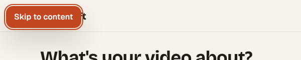
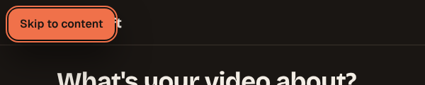

# D4: Accessibility audit (WCAG 2.2 AA) — 2026-10-11

Scope: the shipped core loop (Create, Library, player sheet, header, account menu
with the theme picker) plus a scan of the inherited pages (landing, login,
pricing). Both themes, desktop 1440px, keyboard only. The landing and the
390px mobile layouts get their own pass once their canvases (PR #40) are approved.

## Method

- **axe-core 4.10** (WCAG 2.0/2.1/2.2 A + AA and best-practice rules) in headless
  Chromium, light and dark (`prefers-color-scheme`), in mock mode. Create was run in
  four states (first run, empty idea, not enough credits, plan-locked option) and the
  Library with ready, in-progress, failed and can't-afford-retry cards. Because
  Create and Library need a signed-in user, they were mounted in a throwaway route
  with fixture props, which was **not committed**.
- **Contrast** for every text and UI token pair, both themes (script below).
- **Keyboard run:** Tab order, visible focus on every stop, arrow keys in each radio
  group, opening and closing the player sheet, the account menu and the theme picker.
- **Reduced motion:** computed animation values with `prefers-reduced-motion: reduce`.

## Results

axe: **0 violations** on every screen and state, in both themes, before and after.
The audit found smaller issues that axe doesn't check, and this PR fixes them.

| #   | Issue                                                                                                                                                                   | WCAG                    | Fix                                                                                                                                    |
| --- | ----------------------------------------------------------------------------------------------------------------------------------------------------------------------- | ----------------------- | -------------------------------------------------------------------------------------------------------------------------------------- |
| 1   | Create and Library had the generic site title, so tabs and history all read "Shortcraft — Create viral AI videos in minutes".                                           | 2.4.2 Page Titled       | "Create a video — Shortcraft", "Your videos — Shortcraft"                                                                              |
| 2   | No way to skip the header on any page.                                                                                                                                  | 2.4.1 Bypass Blocks     | "Skip to content" link, the first Tab stop on every page, shown as an ember pill when focused (screenshots below)                      |
| 3   | The System / Light / Dark picker is a radio group, but it had no arrow keys and put all three options in the Tab order. The other radio groups follow the ARIA pattern. | 2.1.1, 4.1.2            | Same `onRadioKeyDown` + roving tabindex as the other groups: arrows and Home/End move the choice, and one Tab stop                     |
| 4   | Esc inside the account menu closed it and dropped focus to `<body>`.                                                                                                    | 2.4.3 Focus Order       | Esc returns focus to the avatar button                                                                                                 |
| 5   | "Not enough credits" and "comes with Pro" were `role="status"` regions that mount together with their text, which screen readers often skip.                            | 4.1.3 Status Messages   | One status region that is always in the page and speaks the change; the visible panels are unchanged                                   |
| 6   | When a video finished while the Library was polling, nothing was announced.                                                                                             | 4.1.3 Status Messages   | Screen-reader-only status: "&lt;title&gt; is ready." / "&lt;title&gt; didn't finish." (`finishedMessage` in `library.ts`, unit-tested) |
| 7   | Under reduced motion, spinners kept an infinite loop at 0.01ms per turn, so they flickered instead of stopping.                                                         | 2.3.3 (AAA) / charter   | Reduced motion also sets `animation-iteration-count: 1` and `scroll-behavior: auto`                                                    |
| 8   | "Use Standard instead" and "Get credits to try again" were 20px tall stand-alone targets.                                                                               | 2.5.8 Target Size (Min) | `min-h-6` (24px). They already passed through the spacing exception; this makes them pass outright                                     |

## Contrast (Paper & Ember tokens)

All text pairs pass 4.5:1 in both themes. The lowest are `ink-muted` on `ember-soft`
(4.91 light) and `on-ember` on `ember` (5.01 light). Selection and focus pass 3:1:
ember against paper, surface and raised is 4.15 or more, and ember against the
resting border is 3.65 light and 4.29 dark. White labels on the photo scrims
(`rgb(20 16 13 / .62)`) reach 5.3:1 even over pure white.

`line` against `surface` is 1.35:1. That is fine for decorative card edges, since every
card is identified by its content, but never use `line` alone to mark a control's
state or boundary. Use `line-strong` (3.4:1 or more) for that.

## Checked and fine

- Focus is visible on every Tab stop in both themes (2px ember outline, 2px offset).
- The player sheet is a native modal `<dialog>`: focus starts on Close, Tab stays in
  the sheet, and Esc or a backdrop click closes it and returns focus to the card.
- All four radio groups (theme, length, quality, filters) now behave the same way.
- Locked lengths keep their plan in the accessible name ("60 seconds, needs Pro") on
  every width.
- Decorative frames, icons and thumbnails are `aria-hidden` or have `alt=""`. The
  meter and progress bars have names and values.

## Left for D3 and later

- 44px touch targets (the charter's mobile bar) for chips and text links: D3 mobile pass.
- The landing page gets the same audit when its code lands (item L).
- Screen-reader smoke test with VoiceOver/NVDA on a real device: needs a person.

 

Library after the fixes (no visual change apart from the 24px retry link):
[light](d4/library-light.png) · [dark](d4/library-dark.png)

---

# D4, part 2: phones (390px) and the landing page — 2026-10-11

Scope: everything shipped by item L (#43) and D3 (#44). That covers the landing, login (the `?idea=` hand-off), Create (normal and plan-locked) and the Library, plus the bottom tab bar and the Account sheet. Each was checked at 390×844 with touch emulation and reduced motion on, in light and dark.

## Method

- **axe-core 4.10** (WCAG 2.0/2.1/2.2 A + AA), same setup as part 1. Create and Library were again mounted with fixture props on a throwaway route that was **not committed**. The landing and login ran on their real routes.
- **Touch targets:** a script measured every visible link, button, input and radio, and listed anything under the charter's 44px phone target. Links inside a sentence are exempt under 2.5.8 and are only listed.
- **Keyboard:** Tab order through the tab bar, then opening the Account sheet, trapping focus, closing it with Esc and returning focus.

## Results

axe found **0 violations** on every page, in both themes.

| #   | Finding at 390px                                                        | Fix (phones only, desktop unchanged)      |
| --- | ----------------------------------------------------------------------- | ----------------------------------------- |
| 1   | Header logo link 32px, "Pricing" 39px, "Log in" 40px, credits pill 38px | `max-md:min-h-11` (44px)                  |
| 2   | Footer links 16px tall                                                  | 44px tall, at least 45px wide             |
| 3   | Create idea chips 40px                                                  | 44px on phones (36px from `sm` as before) |
| 4   | "Use 30s / Standard instead" 24px                                       | 44px on phones                            |
| 5   | Library filter chips 40px                                               | 44px on phones                            |

Already fine:

- Tab bar items are 52px tall and Create is 56×44.
- The Account sheet is a native modal `<dialog>`: focus stays inside after 12 Tabs, Esc closes it, and focus returns to the Account button.
- Sideways rows (themes, ideas, filters) are all reachable by Tab and arrow keys.

## Still open

- **Login form** (inputs 38px, button 36px, "Have an account?" 20px): auth screens are in _Later_ (DesignPlan §4), so this is left to that redesign.
- Inline text links ("See plans", "See full pricing", Terms/Privacy inside sentences) are exempt under 2.5.8.
- **Screen-reader smoke test** with VoiceOver (iOS) and NVDA or TalkBack on a real device: needs a person.
