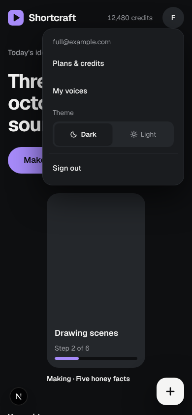
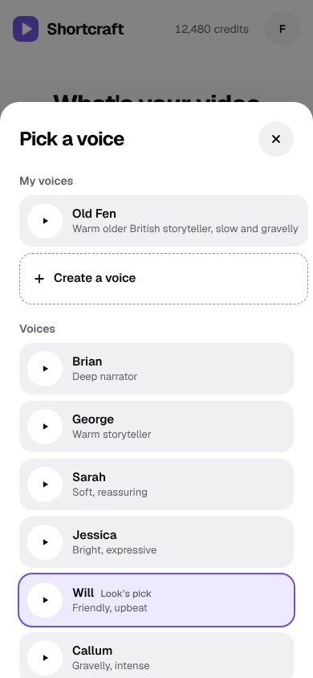
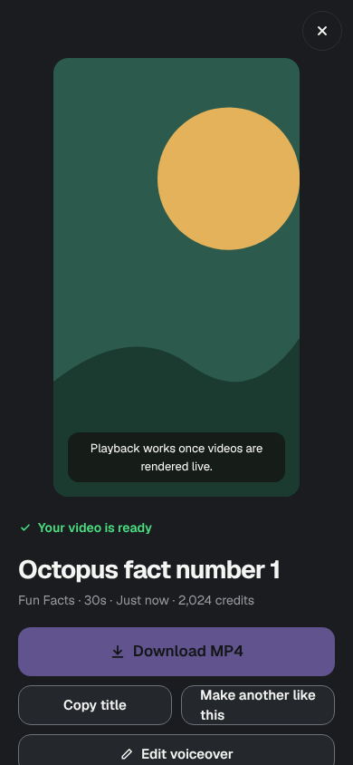
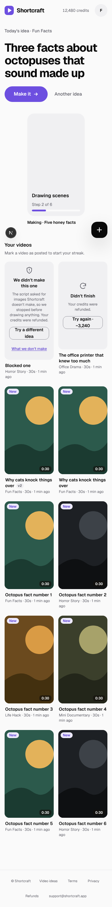

# S4: Calm & Clear check — 2026-10-14

Scope: everything the S journey (Studio tokens #66, Create #67, Home #68, shell #78)
and the Voice Studio screens (V2 #76, V3 #77, V4 #80) shipped. That covers the landing,
login, pricing, Create (first run, normal, not enough credits), the look and voice
sheets, Home ("Your videos") empty and full, the player sheet, the avatar menu, My
voices and Create a voice. Each was checked in dark (the default) and light, at
1440×900 and at 390×844 with touch emulation, with reduced motion on.

## Method

- **axe-core** (WCAG 2.0/2.1/2.2 A + AA and best-practice rules) in headless Chromium,
  in mock mode. The signed-in screens ran on their **real routes**: a throwaway patch
  (not committed) faked three users (new trial account, Pro with 12 videos and a saved
  voice, 40 credits) and seeded the in-memory store. 14 screens and states × 2 themes ×
  2 widths = 56 scans.
- **Touch targets at 390px:** a script measured every visible link, button, input and
  radio and listed anything under the charter's 44px phone target. Links inside a
  sentence are exempt under 2.5.8 and are only listed.
- **5-task walkthrough** with Playwright, counting clicks from the screen a creator
  starts on, at both widths.
- The browser console on Home, for React warnings.

## Results

axe after this PR: **0 violations on all 56 scans.** Before it, 8 scans (Home, My
voices, Create a voice and the avatar menu, both themes, at 390px) had one `region`
violation each.

| #   | Issue                                                                                                                                     | WCAG / charter              | Fix                                                             |
| --- | ----------------------------------------------------------------------------------------------------------------------------------------- | --------------------------- | --------------------------------------------------------------- |
| 1   | The floating "+" (New video) on phones sat outside every landmark, so landmark navigation skipped it (axe `region`).                      | 1.3.1, best practice        | Wrapped in `<nav aria-label="Quick actions">`; no visual change |
| 2   | Avatar menu rows (Plans & credits, My voices, Sign out) were 39px tall on phones.                                                         | Charter: 44px on touch      | `min-h-11` below `md`; desktop unchanged                        |
| 3   | The Dark / Light switch in the avatar menu was 36px tall on phones.                                                                       | Charter: 44px on touch      | `h-11` below `md`, `h-9` from `md`                              |
| 4   | Speed and Delivery (Voice sheet, also used by the voiceover editor) were 40px tall on phones.                                             | Charter: 44px on touch      | `min-h-11` below `md`, `min-h-10` from `md`                     |
| 5   | Home logged a React "unique key" warning on every render: the Today's idea hero crosses from the page into the client grid without a key. | Console hygiene (no visual) | `key="today"` on the hero element                               |

Left as they are (outside this track's files, see DesignPlan §5): the login
"Show" password button is 40px tall, and the pricing waiver checkbox is a 20px box
inside a larger label. Both are under the 44px charter target but pass WCAG 2.5.8 (24px).

## 5-task walkthrough (clicks)

"Before" is the pre-S app (D1–D3 code, counted from the S0 audit); "after" is `main`
plus this PR, measured.

| Task                                 | Before                                | After                                                                 | Note                                                                                                  |
| ------------------------------------ | ------------------------------------- | --------------------------------------------------------------------- | ----------------------------------------------------------------------------------------------------- |
| 1. First video (new account)         | 1 (Generate; sign-in lands on Create) | **1** (Make video; sign-in still lands on Create with an idea filled) | From Home it is 2: Make it → Make video                                                               |
| 2. Make another                      | 2 (idea chip → Generate)              | **2** (Today's idea "Make it" → Make video)                           | Or 3 from a video: card → Make another like this → Make video                                         |
| 3. Find a finished video             | 1 (card), under 5 blocks of actions   | **1** (card), under 1 headline idea + the latest video                | Home now shows 6 controls above the fold at 1440                                                      |
| 4. Download                          | 2 (card → Download)                   | **2**                                                                 | Download is disabled in mock mode (no rendered file)                                                  |
| 5. Mark posted                       | 1 (toggle on the card)                | **2** (card → Mark as posted)                                         | Approved trade-off (S decision: Posted lives in the player). **At 390 the button is below the fold.** |
| Controls on Create before the button | ~20 decisions or texts (S0 audit)     | **7** (idea, Surprise me, 4 pills, Make video)                        | 8 on a trial account (plus "See plans")                                                               |

Click counts held steady; what S changed is how much each screen asks for. The one
place it got slower is marking a video posted on a phone, where the button sits under
Download, Copy title, Make another and Edit voiceover and needs a scroll (see the
open question in DesignPlan §8).

## Checked and fine

- Page titles on every route; the skip link is the first Tab stop.
- The look, length, quality and voice sheets and the player are modal dialogs:
  focus starts inside, Esc closes and returns focus to the pill or card.
- Text pairs pass 4.5:1 in both Studio themes (axe `color-contrast` found nothing,
  including the violet button text and the muted helper lines).
- Reduced motion: the in-progress bar and spinners don't animate.

## Noticed in mock mode (not a design issue)

In `next dev`, route handlers and pages each get their own in-memory store, so a video
started from Create in mock mode doesn't appear on Home. Live (Supabase) is not
affected. Flagged for the main CEO track.

(The round "N" in the bottom corner of the screenshots is the Next.js dev indicator.)
